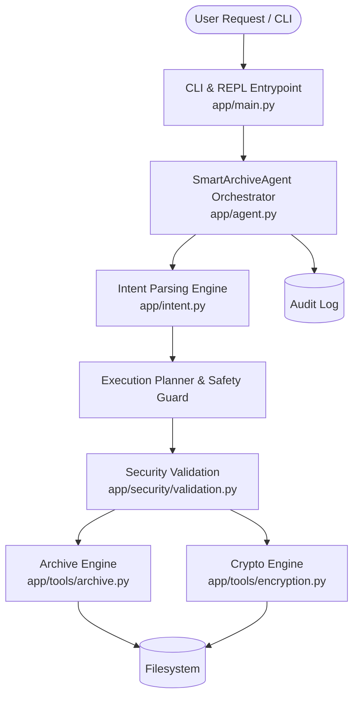

# Smart Archive Agent Architecture

## System Overview

The **Smart Archive Agent** is an autonomous, security-centric file archiving and cryptographic protection system. It translates natural language instructions and high-level goals into safe, multi-step execution plans with built-in path-traversal safeguards and authenticated encryption.

---

## Component Responsibilities

### 1. Agent Orchestrator (`app/agent.py`)
- Acts as the central brain and coordinator.
- Manages plan generation, preview dry-runs, and execution phases.
- Maintains an immutable runtime audit trail with SHA-256 integrity proofs.

### 2. Intent Parsing Engine (`app/intent.py`)
- Understands natural language statements, e.g.:
  - *"archive all .py files in app to backup.zip and encrypt with password Secret"*
  - *"extract package.zip.enc into ./dist with password Secret"*
- Extracts primary action (`ARCHIVE`, `EXTRACT`, `ENCRYPT`, `DECRYPT`, `LIST`, `VERIFY`), target paths, formats, filters, and security parameters.

### 3. Security Validation Subsystem (`app/security/validation.py`)
- **Zip Slip / Path Traversal Prevention**: Resolves target paths relative to strict base boundaries and aborts if any path attempts escape (`../`, root slashes, drive letters).
- **Decompression Bomb Guard**: Analyzes archive headers prior to extraction to detect anomalous compression ratios (> 200:1), total uncompressed byte limits (default 1GB), and file count floods.
- **Cryptographic Verification**: Verifies SHA-256 digests in constant time (`hmac.compare_digest`) to prevent timing side channels.

### 4. Archive Tools (`app/tools/archive.py`)
- Creates and manages archives across multiple formats: `.zip`, `.tar`, `.tar.gz`, `.tar.bz2`, and `.tar.xz`.
- Provides smart filtering by file extensions, patterns, file size bounds, and modification timestamps.
- Automatically excludes runtime noise (`__pycache__`, `.git`, `.DS_Store`).

### 5. Encryption Tools (`app/tools/encryption.py`)
- Provides authenticated symmetric encryption via **AES-256-GCM**.
- Key derivation using **PBKDF2-HMAC-SHA256** (100,000 iterations) with a 16-byte cryptographically secure random salt and a 12-byte initialization vector (nonce).
- Appends `SAA_ENC_v1` magic header for fast file format identification and tamper prevention.
